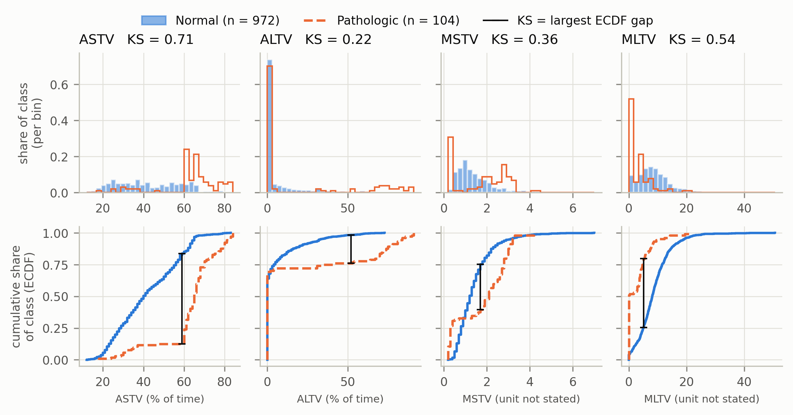
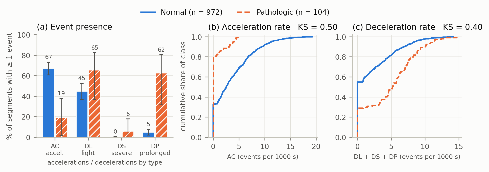
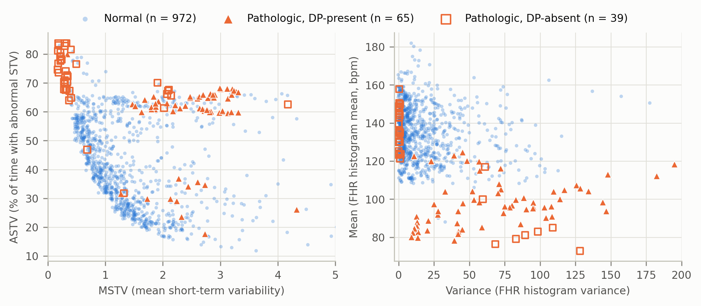

# P2 學習路徑（ELI5 版）：從三個特徵讀懂 §4

- 對象：P2 本人。已經知道任務是 Normal=0、Pathologic=1、一筆是一段 CTG 片段。
- 目標：讀完後，不看稿能回答三題：
  1. ASTV 40 vs 65 是什麼意思？
  2. DP 62.5% vs 4.7% 可以下什麼結論、不能下什麼結論？
  3. MSTV 為什麼不能說「越高越異常」？
- 讀法：**一次只讀一章**，做完章末檢核題再往下。第 3 章請等第 2 章的 Figure 1 能自己講出來再讀。
- 本文所有「本組數字」都來自訓練集（972 筆 Normal、104 筆 Pathologic），由 `python EDA/p2_eda.py` 產生。沒有用到驗證集或測試集。

## 讀之前：四種句子不要混在一起

整份文件的每個說法都屬於下面四層之一。寫報告、回答問題時，要知道自己講的是哪一層。

| 層 | 是什麼 | 來源 | 可以拿來證明什麼 |
|---|---|---|---|
| ① Feature Definition | 這個欄位量的是什麼 | UCI 官方說明 | 只能說明欄位的意思 |
| ② Clinical Intuition | 為什麼醫護人員會在意這個現象 | 外部臨床指引與文獻（不是本資料的標註規則） | 只能當作「為什麼值得看」的動機 |
| ③ Dataset Evidence | 我們的訓練資料實際長什麼樣子 | 本組 train 的統計與圖 | 兩群的分布有沒有差、差多少 |
| ④ Feature Hypothesis | 我們猜這對模型有幫助 | 由 ③ 推出來的猜想 | **什麼都還沒證明**，要等 P5 的消融實驗 |

兩條最容易踩的線：

- ② 不能當成 ③。「臨床上變異度很重要」不等於「我們的資料裡 ASTV 分得開」。後者要看資料。
- ③ 不能當成模型成績。「KS = 0.71」是在描述兩個分布，不是在說模型準確率 71%。模型好不好是 P3／P5 的事。

---

## 第 0 章：P2 到底在做什麼（一頁摘要）

模型還沒訓練之前，先回答一個問題：**光看資料，正常片段和病理片段有哪裡不一樣？**

| 評分要求 | P2 做的事 | 產出 | 對應 |
|---|---|---|---|
| 至少一張分布比較圖 | 把同一個特徵在兩群的分布畫在一起 | Figure 1（變異度）、Figure 2（事件）、Figure 5（子群） | §4 Distribution contrast |
| 量化可分性 | 用一個數字描述「兩個分布差多遠」 | KS、AUC、Mutual Information（`separability.csv`） | §4 Feature separability |
| 檢查冗餘 | 找出講同一件事的特徵 | Spearman 相關、Width = Max − Min | §4 Redundancy |
| 提出假說 | 把觀察變成可以被實驗否定的猜想 | H1、H3（H2′ 為補充） | §4 Exploratory hypotheses |
| 交給後面驗證 | 告訴 P5 要比較哪幾組特徵 | 消融表 | §7–§8（P5 負責） |

一句話：**P2 負責「觀察與提問」，P5 負責「用實驗回答」。** P2 不訓練正式模型，也不宣稱哪個特徵最好。

---

## 第 1 章：三個特徵

三個特徵描述的是三件不同的事，先記住這張表：

| 特徵 | 它在問什麼 | 型態 |
|---|---|---|
| ASTV | 這段時間裡，有**多少比例的時間**短期變異度不正常？ | 百分比（0–100） |
| DP | 這段時間裡，**平均每秒發生幾次**延長減速？ | 事件率（大部分是 0） |
| MSTV | 短期變異度的**平均大小**是多少？ | 連續數值 |

### 1.1 ASTV

**① Definition（UCI 官方）**
“percentage of time with abnormal short term variability”：短期變異度異常的時間百分比。官方只寫到這裡，沒有寫「異常」的門檻。

SisPorto 的相關文獻把「短期變異度異常」定義為相鄰的胎心率讀數相差不到 1 bpm（這是外部文獻的定義，不是 UCI 頁面寫的）。

**玩具例子（純教學，不是資料集裡的樣本）**
一段 10 分鐘的紀錄，電腦判定其中 6 分鐘的心跳「幾乎沒有逐拍變化」：

```
ASTV = 6 分鐘 ÷ 10 分鐘 = 60%
```

所以 ASTV 越高，代表**心跳幾乎不動的時間越長**。注意方向：ASTV 高是「變異度差」，不是「變異度大」。

**② Clinical Intuition（外部知識，不是資料結論）**
健康胎兒的心跳會不停小幅起伏。臨床判讀 CTG 時，變異度是主要依據之一，長時間變異度偏低是需要進一步評估的現象。這只說明「為什麼值得看」，不代表 ASTV 高就等於缺氧。

**③ Dataset Evidence（本組 train）**

| | Normal（972 筆） | Pathologic（104 筆） |
|---|---|---|
| 中位數 | 40 | 65 |
| 中間一半的範圍（第 25–75 百分位） | 29–56 | 61–70 |
| 最小–最大 | 12–83 | 18–84 |
| ASTV ≥ 60 的比例 | 16.3%（158 筆） | 87.5%（91 筆） |

怎麼讀：
- 「中位數 40 vs 65」的意思是：把正常片段照 ASTV 排隊，站在正中間的那一筆是 40；病理片段正中間那一筆是 65。
- 病理片段很集中（中間一半都在 61–70），正常片段很分散（29–56）。
- 兩群**有重疊**：正常片段最高到 83，病理片段最低到 18。

**為什麼不能單獨決定標籤**
假設訂一條規則「ASTV ≥ 60 就示警」：
- 抓到 91 筆病理（87.5%），聽起來不錯。
- 但同時也示警了 158 筆正常。被示警的 249 筆裡，只有 91 筆（37%）真的是病理。

原因是正常片段的數量是病理的 9 倍多，16% 的正常片段在數量上就超過了 87.5% 的病理片段。

### 1.2 DP

**① Definition（UCI 官方）**
“# of prolongued decelerations per second”：每秒的延長減速次數。P1 的做法是把原始次數除以片段長度（秒），和 UCI 的 `Data` 工作表一致。

**玩具例子（純教學）**
一段 10 分鐘（600 秒）的紀錄裡出現 1 次延長減速：

```
DP = 1 次 ÷ 600 秒 ≈ 0.0017 次／秒
```

數字看起來很小，是因為單位是「每秒」。DP = 0 就是整段都沒有延長減速。

**② Clinical Intuition（外部知識）**
減速是胎心率暫時下降。臨床指引把「延長減速」列為需要注意的型態之一，但仍要搭配其他特徵和情境判讀。

**③ Dataset Evidence（本組 train）**

| | Normal（972 筆） | Pathologic（104 筆） |
|---|---|---|
| DP > 0（至少一次延長減速）的比例 | 4.7%（46 筆） | 62.5%（65 筆） |
| DP = 0 的比例 | 95.3% | 37.5%（39 筆） |
| DP > 0 的片段中，DP 的中位數 | 0.0011 | 0.0023 |

因為大部分的值都是 0，所以對 DP 來說，「有沒有出現」比「平均值多少」更適合拿來比較。這就是 Figure 2 用長條圖比較出現率的原因。

**62.5% vs 4.7% 可以下的結論**
- 可以說：在訓練集裡，延長減速在病理片段比在正常片段常見得多。
- 不可以說：「有 DP 就是病理」。DP > 0 的 111 筆裡有 46 筆是正常（41%）。
- 不可以說：「沒有 DP 就是正常」。39 筆病理片段（37.5%）完全沒有延長減速。
- 還要多說一句限制：這 65 筆有 DP 的病理片段只來自 12 次檢查，所以 62.5% 這個數字不太穩（以檢查為單位重抽的 95% 區間是 31%–80%）。

### 1.3 MSTV

**① Definition（UCI 官方）**
“mean value of short term variability”：短期變異度的平均值。**官方沒有寫單位**，也沒有寫計算方式。

**玩具例子（純教學，簡化的概念示意，不是 SisPorto 的實際算法）**
兩段心跳讀數，看相鄰兩個讀數差多少：

```
A 段：140.0  140.2  140.1  140.3     相鄰差：0.2、0.1、0.2   平均約 0.2   → 很平
B 段：140    143    138    141       相鄰差：3、5、3         平均約 3.7   → 起伏大
```

MSTV 小代表曲線很平，MSTV 大代表起伏很大。

**和 ASTV 的差別**：ASTV 問「有多少時間不正常」，MSTV 問「平均起伏多大」。兩者相關但不重複（本組 train 的 Spearman 相關是 −0.36）。

**② Clinical Intuition（外部知識）**
曲線太平值得注意；起伏特別大也可能出現在不正常的監測裡（例如有明顯減速時，心跳上上下下，平均起伏就變大）。也就是說，「不正常」可以往兩個方向發生。

**③ Dataset Evidence（本組 train）**

| | 第 25 百分位 | 中位數 | 第 75 百分位 |
|---|---|---|---|
| Normal（972 筆） | 0.8 | 1.2 | 1.7 |
| Pathologic 全部（104 筆） | 0.3 | 2.1 | 2.8 |
| Pathologic 之中 DP = 0 的 39 筆 | 0.2 | **0.3** | 0.45 |
| Pathologic 之中 DP > 0 的 65 筆 | 2.1 | **2.7** | 3.0 |

換一個角度看，把 MSTV 切成三段：

| MSTV 範圍 | Normal 落在這裡的比例 | Pathologic 落在這裡的比例 |
|---|---|---|
| 很低（≤ 0.5） | 6.6% | 31.7% |
| 中間（0.5–2.0） | **75.5%** | 16.3% |
| 偏高（> 2.0） | 17.9% | 51.9% |

正常片段擠在中間，病理片段往**兩頭**跑。

**為什麼不能說「MSTV 越高越異常」**
因為有三分之一的病理片段 MSTV 特別低。如果只看「越高越可疑」，這一群會被當成最不可疑的。
數字上的證據：
- 用「越高越可疑」來排序，AUC 只有 0.59（0.5 是亂猜）。
- 改用「離正常的平均值越遠越可疑」來排序，AUC 是 0.80。

同一個特徵，換一種看法，結論差很多。這也是 P2 一定要畫分布圖、不能只比平均值的原因。

**關於 DP = 0／DP > 0 這兩群的警語**
這兩群是我們**先挑出 Pathologic，再用 DP 是否大於 0 切開**的描述性子群，正式名稱用 DP-absent／DP-present pathologic segments。它們不是臨床上的病理分型，也不是「不看標籤就發現的群」。

### 1.4 ④ 從觀察到假說

| 觀察（③） | 假說（④，尚未驗證） | P5 怎麼驗證 |
|---|---|---|
| ASTV 分得最開；MSTV 往兩頭偏；四個變異度特徵彼此不重複 | **H1**：變異度特徵群（ASTV、MSTV、ALTV、MLTV）提供其他特徵補不上的偵測資訊 | 模型與資料都不動，只把這四個特徵拿掉，看驗證集的 PR-AUC 有沒有變差 |
| DP 在病理片段常見，但輕度減速 DL 在正常片段也很常見 | **H2′**（補充）：減速的「類型」有資訊，把各種減速加總沒有幫助 | 把 DL、DS、DP 換成一個加總欄位，看有沒有變差 |
| 直方圖特徵彼此高度重複 | **H3**：用正常資料挑掉重複的特徵後，表現大致維持 | 21 個特徵對 20 個（只拿掉 Width）對 17 個 |

假說的寫法有講究：寫「提供互補資訊、待驗證」，不寫「是必要的」。必不必要，要等實驗。

### 第 1 章檢核題

> 朋友說：「病理片段的 ASTV 中位數是 65，正常是 40，所以 ASTV 超過 60 的片段大概都是病理。」請指出哪裡不對，並用本章的數字反駁。

<details>
<summary>參考答案（先自己答再打開）</summary>

不對。ASTV ≥ 60 的片段共有 249 筆，其中 158 筆是正常、91 筆是病理，病理只佔 37%。原因是正常片段的數量是病理的 9 倍多，雖然只有 16.3% 的正常片段超過 60，筆數仍然比病理多。中位數不同只代表兩群的「中心」不同，不代表兩群沒有重疊。

</details>

---

## 第 2 章：只講 Figure 1



檔案：`EDA/figures/fig1_variability_contrast.png`。圖有四欄（ASTV、ALTV、MSTV、MLTV）、兩列。先只看最左邊的 ASTV 那一欄。

### 2.1 圖上有什麼

| 元素 | 意思 |
|---|---|
| 藍色（實心長條、實線） | Normal，972 筆 |
| 橘色（空心線框、虛線） | Pathologic，104 筆 |
| 每欄標題的 KS = … | 這個特徵的 KS 統計量 |
| 下排的黑色直線 | KS 發生的位置：兩條曲線垂直距離最大的地方 |
| X 軸 | 特徵的數值。ASTV、ALTV 是百分比；MSTV、MLTV 官方沒有寫單位，所以軸上標 “unit not stated” |

### 2.2 上排：Histogram（直方圖）

做法：把 X 軸切成一格一格，數每一格裡有幾筆資料。

- **X 軸**：特徵值（例如 ASTV 的 20、40、60、80）。
- **Y 軸**：「該類別有多少比例落在這一格」，不是筆數。

**為什麼 Y 軸用比例而不用筆數？**
Normal 有 972 筆、Pathologic 只有 104 筆。如果畫筆數，橘色會矮到幾乎看不見，看起來像「病理到處都很少」，那只是因為病理本來就少。改成「各自除以自己的總數」後，藍色所有長條加起來是 1，橘色所有線框加起來也是 1，才能公平比較形狀。

**怎麼讀 ASTV 的上排**：藍色從 15 到 65 攤得很平；橘色集中在 60–70 有一個高峰。兩者的「位置」明顯不同。

### 2.3 下排：ECDF（經驗累積分布）

ECDF 回答的問題是：**有多少比例的資料小於或等於 x？**

- **X 軸**：和上排相同的特徵值。
- **Y 軸**：0 到 1 的比例。曲線從左下的 0 爬到右上的 1。

**怎麼讀一個點**：在 ASTV = 59 的位置往上看，
- 藍線大約在 0.84：84% 的正常片段 ASTV ≤ 59。
- 橘線大約在 0.125：只有 12.5% 的病理片段 ASTV ≤ 59。

**怎麼從 ECDF 讀中位數**：找 Y = 0.5 那條水平線，看曲線在哪裡穿過它。藍線在 40 附近、橘線在 65 附近。這就是「中位數 40 vs 65」。

**ECDF 的形狀在說什麼**
- 曲線很陡：很多資料擠在這一段（橘線在 60–70 幾乎是垂直的）。
- 曲線很平：這一段幾乎沒有資料（橘線在 40–59 是平的）。
- 一條線整體在另一條的**右下方**：那一群的數值整體比較大（橘線在藍線右下方，表示病理的 ASTV 比較高）。

**為什麼有了直方圖還要 ECDF？** 直方圖的樣子會隨格子寬度改變，ECDF 不需要切格子，而且 KS 可以直接從 ECDF 上量出來。

### 2.4 KS Statistic

**定義**：兩條 ECDF 之間**最大的垂直距離**。範圍 0 到 1。
- 0：兩條線完全重疊，兩群的分布一模一樣。
- 1：兩條線完全錯開，兩群沒有任何重疊。

**用玩具數字手算一次（純教學數字）**

```
Normal（5 筆）    ：20, 30, 40, 50, 70
Pathologic（4 筆）：45, 60, 65, 80
```

把所有出現過的數字由小到大排，逐一算「各自有多少比例 ≤ x」：

| x | Normal ≤ x | Pathologic ≤ x | 差距 |
|---|---|---|---|
| 20 | 1/5 = 0.20 | 0/4 = 0.00 | 0.20 |
| 30 | 2/5 = 0.40 | 0.00 | 0.40 |
| **40** | 3/5 = **0.60** | **0.00** | **0.60** ← 最大 |
| 45 | 0.60 | 1/4 = 0.25 | 0.35 |
| 50 | 4/5 = 0.80 | 0.25 | 0.55 |
| 60 | 0.80 | 2/4 = 0.50 | 0.30 |
| 65 | 0.80 | 3/4 = 0.75 | 0.05 |
| 70 | 5/5 = 1.00 | 0.75 | 0.25 |
| 80 | 1.00 | 4/4 = 1.00 | 0.00 |

KS = 0.60，發生在 x = 40。意思是：以 40 為界，60% 的 Normal 在界線以下，而 Pathologic 一筆都沒有；這是兩群「落差最大」的地方。

兩群筆數不同（5 和 4）沒有關係，因為比的是比例。

**回到真實資料：ASTV 的 KS = 0.71**

最大差距發生在 ASTV = 59（圖上黑線的位置）：

```
Normal     ≤ 59 的比例：0.837
Pathologic ≤ 59 的比例：0.125
KS = 0.837 − 0.125 = 0.712
```

**KS = 0.71 不是 71% 準確率**
把上面那一刀換成規則「ASTV ≥ 60 就示警」，實際結果是：

| | 示警 | 不示警 |
|---|---|---|
| Pathologic（104） | 91 | 13 |
| Normal（972） | 158 | 814 |

- 準確率 =（91 + 814）÷ 1076 = 84.1%
- 被示警的片段中真的是病理的比例 = 91 ÷ 249 = 37%
- 對照：什麼都不做、全部猜 Normal，準確率是 972 ÷ 1076 = 90.3%

這條規則的準確率（84.1%）比「全部猜正常」（90.3%）還低，KS 卻有 0.71。可見 KS 和準確率是兩回事：KS 只描述兩個分布的形狀差多少，完全不管兩群的筆數比例。

### 2.5 平均數不同，不代表分得開

這是本章最重要的觀念。看三個例子。

**玩具例子**

```
Normal    ：10, 10, 10, 10, 10     平均 10
Pathologic：10, 10, 10, 10, 60     平均 20
```

平均差了一倍，但 5 筆裡有 4 筆和 Normal 完全一樣，根本分不出來（KS = 0.2）。平均數被一個極端值拉走了。

**真實例子一：ALTV（平均差很多，卻分不開）**

| ALTV | Normal | Pathologic |
|---|---|---|
| 平均 | 5.6 | 19.5（約 3.5 倍） |
| 中位數 | 0 | 0 |
| 剛好等於 0 的比例 | 64% | 69% |
| KS | 0.22 | |

平均差了 3.5 倍，可是兩群都有六成以上是 0。病理的平均被少數很高的值（最高 91）拉上去。在 Figure 1 的 ALTV 那一欄可以看到：兩條 ECDF 一開始幾乎重疊地衝到 0.65–0.7，之後才分開。

**真實例子二：MSTV（平均差很少，分布卻很不一樣）**

| MSTV | Normal | Pathologic |
|---|---|---|
| 平均 | 1.43 | 1.80 |
| 落在 0.5–2.0 的比例 | 75.5% | 16.3% |

平均只差 0.37，看起來沒什麼。實際上病理片段分成很低和偏高兩群，一低一高，平均起來剛好落在中間。在 Figure 1 的 MSTV 那一欄可以看到：橘色直方圖有兩個峰，兩條 ECDF 還**交叉**了。交叉就是「不能用單一方向描述」的訊號。

**結論**：平均數只是一個數字，它會被極端值拉走（ALTV），也會把相反方向的偏離互相抵銷（MSTV）。要知道兩群分不分得開，要看整個分布。

### 2.6 四欄各一句話

| 特徵 | KS | 圖上看到什麼 |
|---|---|---|
| ASTV | 0.71 | 橘線整條在藍線右邊，病理明顯偏高 |
| MLTV | 0.54 | 橘線在藍線左邊；一半的病理片段剛好是 0（橘線一開始就跳到 0.5） |
| MSTV | 0.36 | 兩條線交叉；病理往兩頭偏 |
| ALTV | 0.22 | 兩群都有六成以上是 0，只有尾巴不同 |

### 2.7 報告式的寫法（照圖上的真實數值）

**三句觀察**
1. 在訓練集中，病理片段的 ASTV 整體較高：中位數為 65，正常片段為 40，KS 為 0.71。
2. MLTV 在病理片段集中於低值：51% 的病理片段 MLTV 為 0，正常片段只有 4%。
3. MSTV 在病理片段呈雙峰，兩條累積分布曲線交叉，因此單一方向的差異（KS 0.36）低估了它與正常片段的不同。

**兩句限制**
1. 104 筆病理片段只來自 28 次檢查，其中 2 次檢查佔 36 筆；同一次檢查的片段彼此相似，所以 KS 的不確定性比筆數看起來的大（ASTV 的 95% 區間為 0.56–0.84）。
2. 這些是訓練集的描述性差異，兩群仍有重疊（16% 的正常片段 ASTV ≥ 60）；它們不是分類規則，也不代表模型效能。

### 第 2 章檢核題

> 不看上面的表，回答：ASTV 的 KS = 0.71 是在圖上的哪裡量出來的？它代表「71% 的病理片段被找出來」嗎？

<details>
<summary>參考答案</summary>

是在下排 ECDF 圖上，藍線與橘線垂直距離最大的地方量出來的，位置在 ASTV = 59：84% 的正常片段在 59 以下，而病理片段只有 12.5% 在 59 以下，兩者相減是 0.71。

它不代表 71% 的病理被找出來。如果真的在 59 切一刀，87.5% 的病理片段在界線以上，但同時有 16% 的正常片段也在界線以上。KS 是「兩個比例的差」，描述的是分布差異，不是找出率，也不是準確率。

</details>

---

## 第 3 章：Figure 2 與 Figure 5

請先確認第 2 章的 Figure 1 可以自己講一遍，再讀這一章。

### 3.1 Figure 2：事件有沒有出現



**為什麼這張不用直方圖？** 因為 DP 有 90% 是 0、DL 有 53% 是 0。直方圖會變成 0 的地方一根超高的柱子，其他什麼都看不到。所以改問比較適合的問題：這種事件有沒有出現？

**左圖 (a)：出現率長條圖**

| 元素 | 意思 |
|---|---|
| X 軸 | 四種事件：AC 加速、DL 輕度減速、DS 重度減速、DP 延長減速 |
| Y 軸 | 該類別中「至少出現一次」的片段比例（%） |
| 藍色實心／橘色斜線 | Normal／Pathologic |
| 長條上的數字 | 比例 |
| 黑色誤差線 | 95% 區間，以「檢查」為單位重抽得到 |

**一句數據證據**：延長減速（DP）在 62.5% 的病理片段出現，在正常片段只有 4.7%；加速（AC）則相反，67% 的正常片段有加速，病理片段只有 19%。

**怎麼看誤差線**：橘色的誤差線都很長（DP 是 31%–80%），藍色的很短。這不是畫錯，是因為病理片段只來自 28 次檢查，換一批檢查，比例可能差很多。

**為什麼 DL 不是好特徵**：輕度減速在正常片段就有 45%，病理是 65%，兩根長條差不多高，誤差線還重疊。

**右邊兩張 (b)(c)**：和 Figure 1 下排一樣是 ECDF。兩條線一開始在 X = 0 的地方垂直往上跳，跳多高就是「有多少比例是 0」。在 (b) 可以看到橘線一開始就跳到 0.8：八成的病理片段完全沒有加速。

**限制**：DS（重度減速）在整個訓練集只有 7 筆不是 0，那兩根長條幾乎沒有統計意義。

### 3.2 Figure 5：把病理片段依 DP 分成兩個子群



**這張圖的類型**：散佈圖。一個點是一段片段，位置由兩個特徵決定。

| 元素 | 意思 |
|---|---|
| 藍色小圓點 | Normal（972 筆） |
| 橘色實心三角 | Pathologic 且 DP > 0（DP-present，65 筆，來自 12 次檢查） |
| 橘色空心方框 | Pathologic 且 DP = 0（DP-absent，39 筆，來自 18 次檢查） |
| 左圖 X／Y 軸 | MSTV／ASTV |
| 右圖 X／Y 軸 | 直方圖的 Variance／Mean |

**左圖怎麼讀**
- 空心方框擠在左上角：MSTV 很低（約 0.3）、ASTV 很高（約 70 以上）。
- 實心三角在右邊中間：MSTV 偏高（2–3）、ASTV 在 60–68。
- 藍色點雲在中間偏下。
- 兩群橘色點在 MSTV 這個方向上，分別落在藍色點雲的**左邊和右邊**；在 ASTV 這個方向上則**都偏高**。

這張圖把第 1 章 MSTV 的表格畫出來了：

| | MSTV 中位數 | ASTV 中位數 |
|---|---|---|
| Normal | 1.2 | 40 |
| DP-absent pathologic | 0.3 | 71 |
| DP-present pathologic | 2.7 | 62 |

**右圖怎麼讀**：空心方框貼在最左邊（Variance 接近 0，心率幾乎不變），實心三角在右下方（Variance 大、Mean 低，表示整段心率被減速拉低）。

**這張圖對假說的意義**：兩個子群在不同的特徵上偏離正常，所以我們猜「變異度特徵」和「事件特徵」各自抓到不同的病理片段。這就是為什麼假說以「特徵群」為單位，並建議 P5 分別報告兩個子群的召回率。

**三條限制（寫報告時要一起寫）**
1. 子群是先用 Pathologic 標籤篩選、再用 DP 切開的，是描述性分組，不是臨床分型，也不是不看標籤的發現。
2. DP-present 的 65 筆只來自 12 次檢查，有 2 次檢查同時出現在兩個子群。
3. 圖上的點加了很小的隨機位移，只是為了避免重疊（很多值是整數），不影響任何統計量。

### 第 3 章檢核題

> 「病理片段的 MSTV 比正常高，所以 MSTV 越高越異常。」請用 Figure 5 和第 1 章的數字說明這句話為什麼不完整。

<details>
<summary>參考答案</summary>

病理片段裡 DP = 0 的 39 筆，MSTV 中位數只有 0.3，比正常的 1.2 還低；DP > 0 的 65 筆中位數是 2.7，比正常高。也就是病理片段往兩個方向偏離。若只用「越高越異常」，會把 MSTV 很低的那一群當成最正常的。數字上，用「越高越可疑」排序的 AUC 只有 0.59，用「離正常平均越遠越可疑」排序則是 0.80。

</details>

---

## 讀完之後

| 下一步 | 檔案 |
|---|---|
| 想知道這些數字是怎麼算出來的 | `EDA/docs/p2_code_walkthrough_zh.md` |
| 想看 §4 英文稿每一段在講什麼 | `EDA/docs/p2_section4_explanation.md` |
| 想看假說與 P5 的消融表 | `EDA/docs/p2_hypotheses.md` |

三題自我檢查（開頭的目標）：

1. ASTV 40 vs 65：兩群各自排隊後正中間那一筆的值；病理整體偏高，但兩群有重疊。
2. DP 62.5% vs 4.7%：延長減速在病理片段常見得多；但有 DP 的片段四成是正常，沒有 DP 的病理片段佔 37.5%，而且數字只來自 12 次檢查。
3. MSTV：病理片段一群很低、一群偏高，方向相反，所以要看「離正常多遠」，不能看「越高越異常」。
